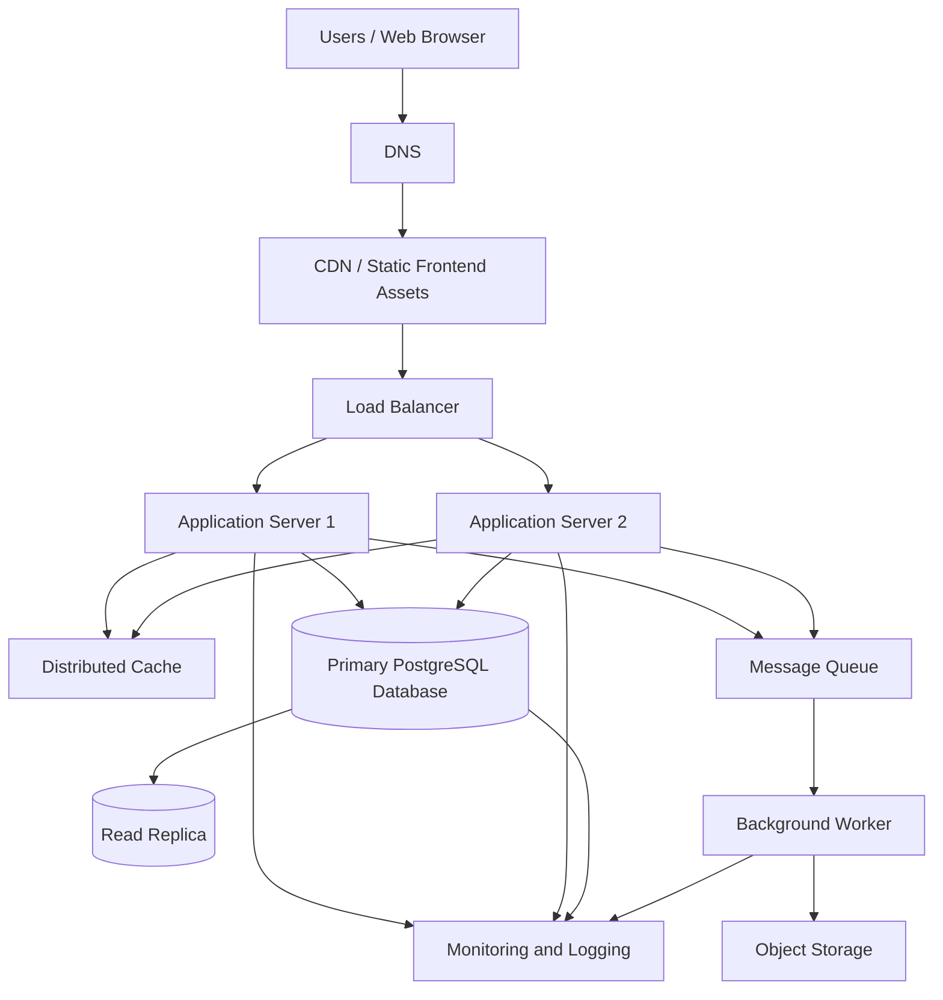

# QuickNotes System Architecture

## 1. Overview

QuickNotes is a cloud-based note-taking application that allows users to register, create notes, view notes, update notes, and organize notes using tags.

The system is designed to support up to 1 million registered users.

The architecture uses multiple application servers, caching, database replication, and background processing to improve availability, performance, and scalability.

## 2. Functional Requirements

The system must allow users to:

1. Register and log in securely.
2. Create new notes.
3. View all their notes.
4. View individual notes.
5. Update existing notes.
6. Delete notes.
7. Organize notes using tags.
8. Search and filter their notes.
9. Access their notes from different devices.

## 3. Non-Functional Requirements

The system should provide:

- **Scalability:** Support increasing numbers of users and requests.
- **Availability:** Remain accessible when an application server fails.
- **Performance:** Return common note queries quickly.
- **Security:** Protect user accounts and private notes.
- **Reliability:** Prevent data loss and maintain database consistency.
- **Maintainability:** Allow components to be updated independently.
- **Data durability:** Back up important application data regularly.

## 4. Capacity Planning and Load Estimates

The following estimates use 1 million registered users.

Since not all registered users are active every day, the calculations use reasonable assumptions.

### 4.1 Assumptions

| Metric | Assumption |
|---|---:|
| Registered users | 1,000,000 |
| Daily active users (DAU) | 20% |
| Daily active users | 200,000 |
| Read requests per active user per day | 20 |
| Write requests per active user per day | 2 |
| Average note content size | 2 KB |
| Peak traffic multiplier | 5x |
| Days per year | 365 |

For storage estimation, we assume each write creates one new note. This is a simplified planning assumption, not a prediction of actual user behaviour.

### 4.2 Read Requests Per Second

200,000 active users make 20 read requests each per day.

Total daily reads:

200,000 × 20 = 4,000,000 reads per day.

Average reads per second:

4,000,000 ÷ 86,400 = 46.3 reads per second.

Estimated peak reads:

46.3 × 5 = 231.5, approximately 232 reads per second.

### 4.3 Write Requests Per Second

200,000 active users make 2 write requests each per day.

Total daily writes:

200,000 × 2 = 400,000 writes per day.

Average writes per second:

400,000 ÷ 86,400 = 4.63 writes per second.

Estimated peak writes:

4.63 × 5 = 23.15, approximately 24 writes per second.

### 4.4 Annual Storage Estimate

Assume each new note uses an average of 2 KB of storage.

Daily storage:

400,000 notes × 2 KB = 800,000 KB, approximately 800 MB per day.

Annual storage:

800 MB × 365 = 292,000 MB, approximately 292 GB per year.

This is the estimated raw note content storage.

Actual database storage will be higher because it also includes:

- User records.
- Note and tag metadata.
- Database indexes.
- Transaction logs.
- Backups and replication overhead.

### 4.5 Capacity Planning Summary

| Metric | Average Estimate | Peak Estimate |
|---|---:|---:|
| Read requests per second | 46.3 | 232 |
| Write requests per second | 4.63 | 24 |
| New notes per day | 400,000 | Not applicable |
| Raw note storage per year | 292 GB | Not applicable |

These figures provide an initial planning baseline. Actual capacity should be adjusted using production monitoring and real usage patterns.

## 5. High-Level System Architecture

The following diagram shows the main components and how they communicate.

## 6. Explanation of Architecture Components

### 6.1 Client

The client is the user's browser or mobile application.

It provides the interface for creating, viewing, updating, and deleting notes.

### 6.2 DNS

DNS translates the application domain name into the IP address of the appropriate infrastructure endpoint.

This allows users to access QuickNotes using a domain name rather than remembering an IP address.

### 6.3 CDN

A Content Delivery Network distributes static frontend assets such as JavaScript, CSS, images, and other public files.

It reduces the load on the origin infrastructure and improves content delivery speed.

Private notes and authenticated API responses must not be publicly cached.

### 6.4 Load Balancer

The load balancer distributes incoming API traffic across multiple application servers.

It performs health checks and avoids sending new requests to unhealthy servers.

### 6.5 Application Servers

At least two application servers run the QuickNotes backend.

They handle authentication, validation, business logic, and communication with the database.

Multiple servers provide capacity and reduce dependence on a single application server.

### 6.6 Distributed Cache

A distributed cache such as Redis stores frequently accessed information.

It can reduce repeated database queries and improve response times.

Examples include frequently accessed note lists and short-lived session or token-related data.

Private cached data must be isolated by user and protected with appropriate expiration and invalidation rules.

### 6.7 Primary Database

The primary PostgreSQL database stores the application's main data.

It handles writes such as creating, updating, and deleting notes.

### 6.8 Read Replica

The read replica receives replicated database changes from the primary database.

It handles suitable read-heavy queries, reducing the workload on the primary database.

Some reads may briefly return older data because replication is asynchronous.

### 6.9 Message Queue

A message queue temporarily stores background tasks that do not need to be completed during the user's immediate request.

Examples include sending notifications and processing audit events.

### 6.10 Background Worker

Background workers retrieve tasks from the queue and process them independently of the application servers.

This keeps the main application responsive while longer-running tasks are handled in the background.

### 6.11 Object Storage

Object storage provides a place to store files and attachments if QuickNotes supports them in the future.

The application database stores metadata and references to these files rather than storing large files directly in database records.

### 6.12 Monitoring and Logging

Monitoring collects system metrics, application errors, database performance, and server health information.

It helps the operations team identify problems and respond before they significantly affect users.

## 7. Request Flow

### 7.1 GET /notes: Retrieving Notes

When a user requests their notes, the following steps occur:

1. The user opens QuickNotes and requests their notes.
2. DNS resolves the application domain.
3. The CDN delivers static frontend assets where applicable.
4. The request reaches the load balancer.
5. The load balancer forwards the API request to a healthy application server.
6. The application server validates the user's access token.
7. The application checks the distributed cache for the requested notes.
8. If the cache contains valid data, the application returns it.
9. If the cache does not contain the data, the application queries the read replica or primary database as appropriate.
10. The application returns the notes to the client and may update the cache.

The system must ensure that cached results are only returned to the correct authenticated user.

### 7.2 POST /notes: Creating a Note

When a user creates a note, the following steps occur:

1. The user submits a note through the frontend.
2. The request reaches the load balancer.
3. The load balancer forwards it to a healthy application server.
4. The application server validates the access token.
5. The application validates the note title and content.
6. The application verifies that the user is authorized to create the note.
7. The application writes the new note to the primary PostgreSQL database.
8. The database confirms the transaction.
9. The application invalidates or updates any affected cached note data.
10. The application returns a `201 Created` response to the frontend.

If additional background work is required, such as sending a notification, the application can publish a task to the message queue.

## 8. Scalability Strategies

The system uses several approaches to support growth.

**Horizontal scaling:** Add more application servers when request volume increases.

**Caching:** Use Redis to reduce repeated database queries.

**Database replication:** Send suitable read requests to read replicas.

**Load balancing:** Distribute traffic across healthy application servers.

**Background processing:** Use queues and workers for tasks that do not need to block user requests.

**Pagination:** Return notes in manageable batches instead of loading every note at once.

**Monitoring:** Track traffic, response times, database connections, errors, and storage growth.

## 9. Architecture Trade-Offs

### Trade-Off 1: SQL vs NoSQL

PostgreSQL provides strong relationships and data integrity for users, notes, and tags.

However, relational databases require careful schema design and may need additional scaling work as traffic increases.

**Decision:** Use PostgreSQL because QuickNotes has structured data and clear relationships.

### Trade-Off 2: Caching vs Data Consistency

Caching improves performance by reducing database queries.

However, cached information may become outdated after a note is updated or deleted.

**Decision:** Use cache expiration and explicit cache invalidation after relevant note changes.

### Trade-Off 3: Read Replicas vs Immediate Consistency

Read replicas improve read capacity but may lag behind the primary database.

**Decision:** Use the primary database for operations that require immediate consistency, such as confirming a newly created or updated note. Use replicas for suitable read-heavy operations.

### Trade-Off 4: Synchronous vs Asynchronous Processing

Synchronous processing completes work during the user's request, but lengthy operations can slow down the response.

Asynchronous processing moves suitable tasks to a queue, but introduces additional infrastructure and monitoring requirements.

**Decision:** Keep essential note operations synchronous, while moving non-critical background tasks to workers.

## 10. High Availability and Avoiding Single Points of Failure

A single point of failure is a component whose failure could make the entire application unavailable.

QuickNotes reduces these risks through the following measures:

1. **Multiple application servers:** If one server fails, the load balancer can route traffic to another healthy server.
2. **Load balancer redundancy:** Deploy the load balancing service in a highly available configuration.
3. **Database backups:** Perform regular backups and test database restoration.
4. **Database failover:** Maintain a standby or replica that can be promoted if the primary database fails.
5. **Queue durability:** Use a durable message queue so pending tasks are not lost when a worker becomes unavailable.
6. **Worker redundancy:** Run multiple background workers so that processing can continue if one worker fails.
7. **Monitoring and alerts:** Detect infrastructure failures and unusual performance before they cause extended downtime.

A read replica alone is not a complete disaster recovery solution. The system also needs tested backups, recovery procedures, and a defined recovery objective.

## 11. Conclusion

The QuickNotes architecture uses a layered and scalable design to support one million registered users.

The load balancer distributes traffic across multiple application servers, Redis reduces repeated database queries, and PostgreSQL stores the application's structured data.

Read replicas improve read capacity, while queues and background workers handle non-critical processing.

With monitoring, backups, redundancy, and appropriate scaling, the system can grow while maintaining performance, availability, and data security.

